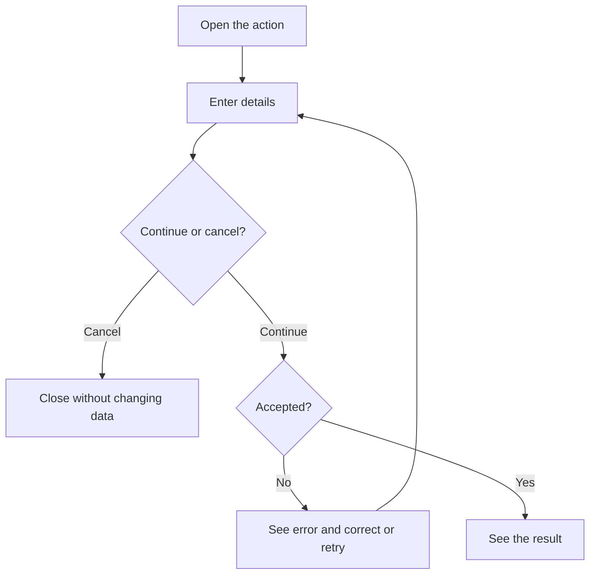
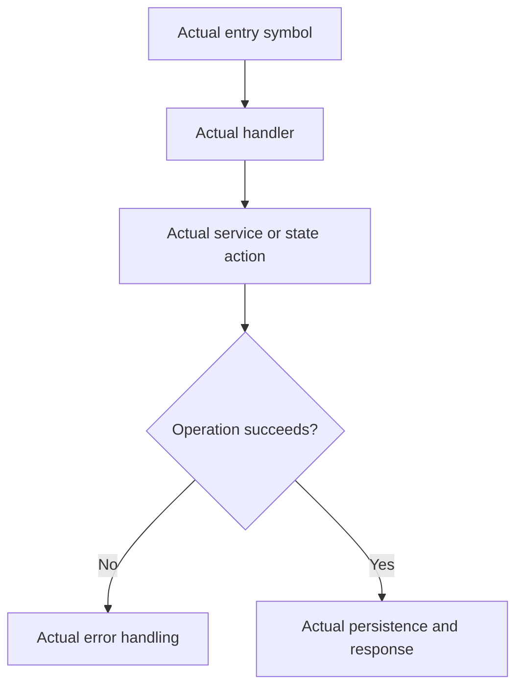

# User story template

A story records one meaningful user or operator action and its purpose. Replace all bracketed text and example symbols with source-backed repository details. Keep this document portable: it does not depend on private workflow files.

## Story example

The catalogue's [guarded-command story](US-GUARD-01-execute-command.md) is the repository-specific example. Copy its structure, then adapt the action and both diagrams to the new outcome.

````markdown
# US-AREA-NN — Action title

As a [role], I want to [action] so that [useful outcome].

**Status:** [Current / Hidden / Removed / Demo / Operator / Planned; explain unavailable entry]
**Access:** [Actual roles and relevant conditions]
**Entry:** [Screen, route and exact visible control, API, or explicitly unavailable]
**Documentation:** [Relevant guide](../README.md), or state that none exists
**Source:** [Entry implementation](../src/receipts.ts)
**Coverage:** [Relevant test, optional](../tests/execute.spec.ts)

## Acceptance criteria

| Field                                     | Control                         | Required/default/conditions                                                                   |
| ----------------------------------------- | ------------------------------- | --------------------------------------------------------------------------------------------- |
| [Exact visible label or actual API input] | [Control type or API parameter] | [Required/optional, default, limits, options, dependent choices, visibility, read-only state] |

- [Observable success result.]
- [Relevant cancellation, refusal and failure behavior.]

## User flow



## Code flow

Scope: [Whole path, or explicitly named shared/host-owned boundary.]



**Code references:** [Entry](../src/receipts.ts), [Handler](../src/receipts.ts)
````

## Actions without input fields

Replace the field table with a short list of controls and their visible results. Do not create empty or artificial field rows. For a package action with no UI, list the actual service inputs and returned values instead. Include confirmation controls and relevant cancellation or failure results when they affect the action. Example: `- **Prune expired confirmations** removes spent or expired rows and returns the number deleted.` This repository-specific API outcome is an example; replace it with an outcome that exists in the target repository.

## Writing and maintenance rules

- Use one story per meaningful outcome. An inseparable set of controls may share a story;
  independently useful actions deserve their own. Create and edit are distinct actions.
  When splitting, preserve the original ID/path for one outcome and give the other the next unused
  ID; update catalogue references and counts together.
- Include every relevant field, including conditional and read-only fields. Record exact labels,
  required/optional state, defaults, limits, available options and dependent choices. For dynamic
  choices, describe their source and filtering rules rather than listing transient data.
- Edit forms include current-value prefills. API/library/CLI actions document real argument names,
  required values, omission/null defaults, flag/prompt behavior and limits. Verify what callbacks
  receive before assigning host policy to them.
- Link an identical shared field list and describe create/edit differences locally. Do not make
  readers chase several links to discover a form.
- Keep acceptance criteria concise and observable. Avoid detailed test scripts and exhaustive
  backend guarantees; keep those in tests and the authoritative decision record.
- Keep identifiers and filenames stable. Add the next unused identifier within the area. Retain
  intent and mark availability when a feature disappears, unless retirement is explicitly authorized.
- Use the availability definitions below. Explain unavailable entries and identify historical or
  intended controls clearly. Retention does not promise restoration or authorize new functionality.
  State opt-in capabilities and required hooks; trace account-state and permission requirements
  for this operation instead of copying them from a neighboring action.
- An optional **Coverage:** test link identifies supporting tests; it does not claim they were run.
  Keep runtime results separate from source-reviewed availability.
- Verify source rather than inheriting stale copy. Update the index (README.md), coverage matrix
  (COVERAGE.md), shared reference (REFERENCE.md) and decision gaps (GAPS.md) alongside affected stories.
  Adapt these names to the repository's established equivalents.
- Reconcile copied examples in TEMPLATE.md too. Close review findings with source evidence for
  each correction; green checks alone do not establish that an inaccurate claim is fixed.
- Record differences between agreed targets and current implementation in the gaps record without
  silently changing either. “New” in the coverage matrix means newly documented, not newly implemented.

## Availability definitions

| Status   | Meaning                                                                 |
| -------- | ----------------------------------------------------------------------- |
| Current  | Exposed, subject to stated roles, configuration and conditions          |
| Hidden   | Implementation remains but its ordinary entry or trigger is unavailable |
| Removed  | Historical capability has no current product entry                      |
| Demo     | Available only in the specified demo context                            |
| Operator | Installation, hosting or recovery outside the ordinary application UI   |
| Planned  | Agreed target without an ordinary implemented journey                   |

Read Status with Access and Entry. A configured feature switch is a condition, not proof of removal.
Current describes availability, not a browser test result. Preserve equivalent repository status
semantics and explain their mapping where an established scheme differs.

## Diagram conventions

- Every story has User flow and Code flow sections, each containing a Mermaid flowchart. The first
  uses screens, actions, decisions and outcomes a person understands; the second names the actual
  implementation. Link supporting files under Code references.
- Keep diagrams focused on the action. Include meaningful choices, cancellation, refusal, failure
  and recovery where they affect the journey; avoid repeating every validation or security rule.
- Trace producers and consumers: entry, handler, state or service, persistence where applicable
  and resulting UI. A retained component or setter alone does not prove a reachable journey.
- Distinguish server writes, device preferences and read-only actions. Verify the demo's actual
  path. Do not infer server authorization from hidden controls.
- Trace each client and authentication strategy separately. Show actual response fields and
  prerequisite-token sources; browser rendering, API acknowledgements and audit events may differ.
  Keep real calls on the branches that execute them, including client-specific queries.
- Place guards and validation before the operations they govern. Include early no-op returns,
  scope/replacement effects and refusals that consume proof or leave committed state in place.
  Distinguish confirmation/completion recipients and attempted cleanup from guaranteed removal;
  show recovery when these differences affect the action. Bounded counts describe the current run.
- Code labels must name existing symbols or explicitly identify absent/intended controls. State
  the scope when a diagram stops at a shared boundary.
- For Hidden, Removed or Planned features, label the intended user flow as unavailable. Show the
  actual missing entry/trigger and retained support in the code flow without implying execution.
- Reconcile labels and branches against source. Parse changed Mermaid diagrams and inspect
  representative rendering; report any check that could not be completed. Syntax validation does
  not establish behavioral correctness or prove a browser journey was exercised.
- Tie validation and CI to the final content/revision, distinguish skipped jobs from successful
  gates and reuse evidence only for unchanged guarantees. Report source review, documentation
  checks and runtime journeys separately.
