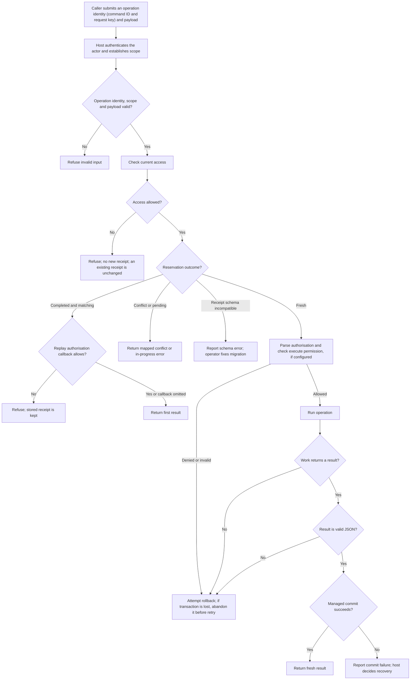
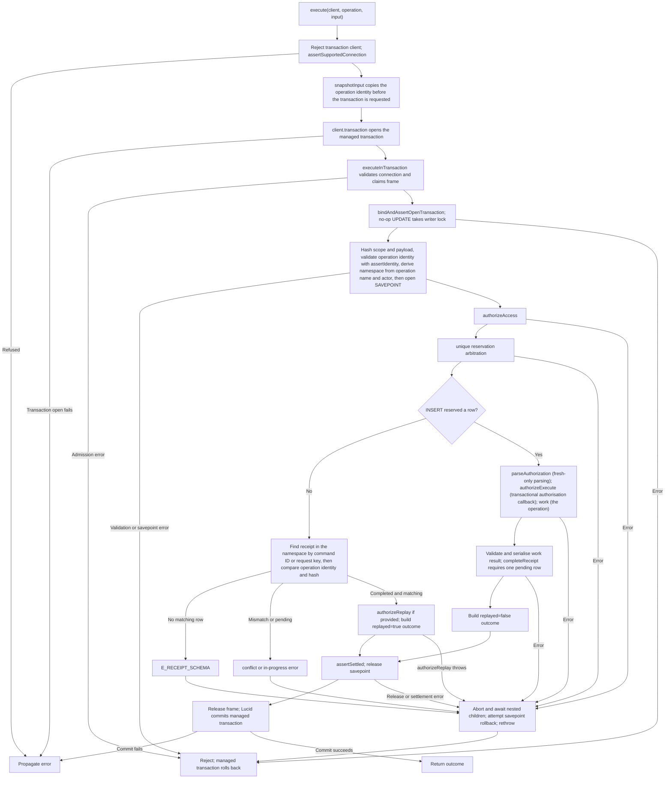

# US-GUARD-01 — Run a deduplicated operation once

As an operation caller, I want to reuse the same operation identity on retries so that I get the first result instead of applying the change twice.

**Status:** Current when using a supported better-sqlite3 connection and the required receipts migration.
**Access:** Host authenticates the actor, establishes the scope, and authorises access. The operation name and actor define the receipt namespace. Replay requires a matching operation identity, scope, and payload.
**Entry:** Host action calls `execute(client, operation, input)`; client supplies the operation identity as `commandId` and `requestKey`.
**Documentation:** [README use and contracts](../README.md#use)
**Source:** [`execute` and reservation pipeline](../src/receipts.ts)
**Coverage:** [`tests/execute.spec.ts`](../tests/execute.spec.ts), [`tests/values.spec.ts`](../tests/values.spec.ts)

## Acceptance criteria

| Input                                     | API parameter                | Required/default/conditions                                                                                                                                                                     |
| ----------------------------------------- | ---------------------------- | ----------------------------------------------------------------------------------------------------------------------------------------------------------------------------------------------- |
| `actorId`, `scopeId`                      | String-typed identity values | Required by `ExecuteInput`; host derives identity and scope from trusted authentication and authorisation. No additional nonempty-string runtime check is promised.                             |
| `command.commandId`, `command.requestKey` | Operation identity           | Both values are required and must be well-formed Unicode strings. Preserve the command ID and request key together on retries. The operation name and actor define the receipt namespace.       |
| `payload`                                 | Operation payload            | Required JSON value; scope and payload are hashed together. Objects must be plain; arrays and finite numbers are allowed.                                                                       |
| `authorization`                           | Opaque optional input        | Parsed only for fresh reservations when `parseAuthorization` exists; omitted parser supplies `undefined`. A non-optional `Authorization` type requires a parser in the public `Operation` type. |

- The package first acquires SQLite's writer lock, then validates the payload and scope JSON and the operation identity before any authorisation callback. `authorizeAccess` is the first authorisation callback and runs before reservation. Invalid payloads do not commit a receipt.
- `Operation` requires `name`, `authorizeAccess`, and `work`; omitted execute/replay authorisation callbacks allow their respective path. Use only the provided `trx` for database changes.
- A fresh reservation calls `parseAuthorization(raw)` when present, then `authorizeExecute(context, authorization)` when present, then `work(context, authorization)`. Context contains `actorId`, `scopeId`, `payload` and `trx`; the parser receives no context. It stores a plain JSON result in the same transaction and returns the original value with `replayed: false`. `execute` opens one transaction and does not retry automatically.
- Within the receipt namespace, reusing a command ID or request key finds an existing receipt. A mismatch in either value, scope, or payload reports a conflict.
- A matching completed receipt returns the stored JSON-equal result with `replayed: true` after replay authorisation if configured. Calling `executeIn(trx, operation, input)` from `work` or `authorizeExecute` with the same `trx` and matching values reports that the operation is in progress.
- A fresh-path failure after the savepoint opens triggers rollback of its receipt and writes. If SQLite already ended the transaction, savepoint cleanup can fail; the original error is preserved and the host must abandon that transaction ([US-GUARD-06](US-GUARD-06-recover-transaction.md)).
- Non-JSON values (including cycles, dates, non-finite numbers, symbols and class instances) are refused; `-0` replays as `0`.

- Preserve the operation identity on retries. Property order does not change the payload hash. Changing the scope or a JSON value while reusing the operation identity conflicts within the same receipt namespace. Keep the payload unchanged until the call settles. Invalid input raises `E_INVALID_COMMAND_VALUE`; an invalid work result raises `E_INVALID_COMMAND_RESULT` and rolls back the work. See [identity cases](../tests/identity.spec.ts) and [JSON value cases](../tests/values.spec.ts).

## User flow

## Code flow

Scope: package operation path; caller authentication, HTTP response shaping, and response presentation remain host-owned; operation callbacks must be database-only.

**Code references:** [API](../index.ts), [execute](../src/receipts.ts#L728), [Operation](../src/types.ts#L41)
