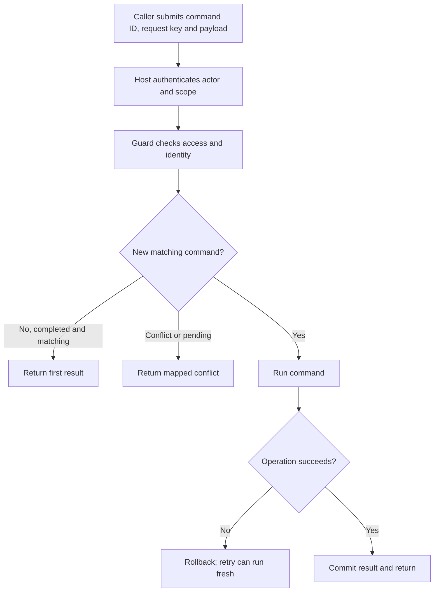
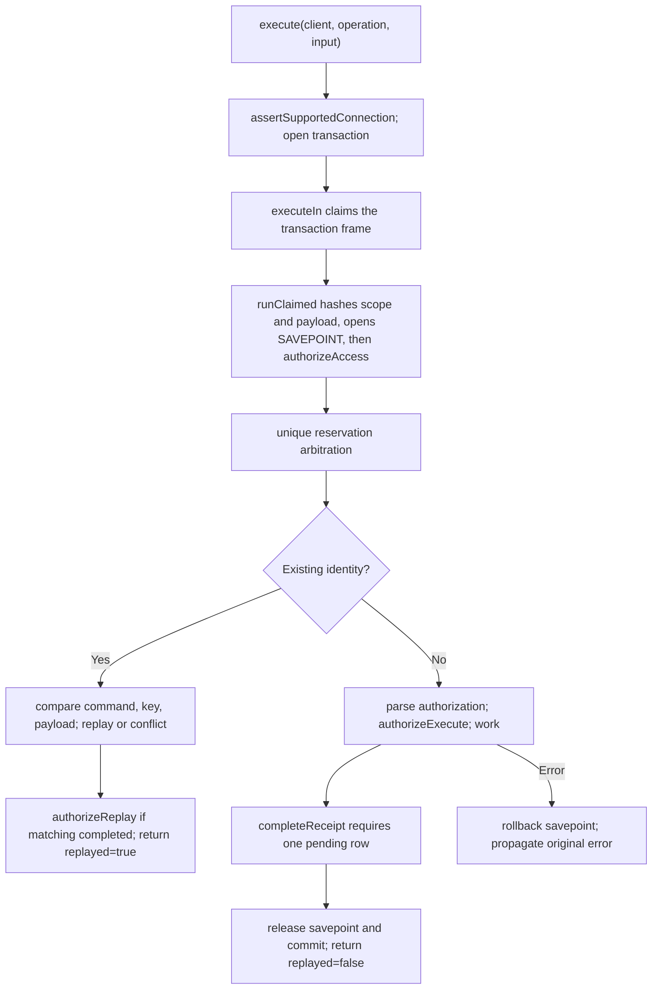

# US-GUARD-01 — Run a guarded command once

As a command caller, I want to submit a command with a stable identity so that retries return its first result instead of applying the change twice.

**Status:** Current when using a supported better-sqlite3 connection and the required receipts migration.
**Access:** Host authenticates actor/scope and authorizes access. Command identity is scoped to operation name and actor; payload plus scope must match for replay.
**Entry:** Host action calls `execute(client, operation, input)`; client supplies `commandId` and `requestKey`.
**Documentation:** [README use and contracts](../README.md#use)
**Source:** [`execute` and reservation pipeline](../src/receipts.ts)
**Coverage:** [`tests/execute.spec.ts`](../tests/execute.spec.ts), [`tests/values.spec.ts`](../tests/values.spec.ts)

## Acceptance criteria

| Input                                     | API parameter                        | Required/default/conditions                                                                                                                                                                   |
| ----------------------------------------- | ------------------------------------ | --------------------------------------------------------------------------------------------------------------------------------------------------------------------------------------------- |
| `actorId`, `scopeId`                      | String-typed identity values         | Required by `ExecuteInput`; host derives identity and scope from trusted authentication/policy. No additional nonempty-string runtime guard is promised.                                      |
| `command.commandId`, `command.requestKey` | String-typed client command identity | Both required; preserve the pair on a retry. Operation name plus actor forms a separate receipt namespace.                                                                                    |
| `payload`                                 | Operation payload                    | Required JSON value; scope and payload are hashed together. Objects must be plain; arrays and finite numbers are allowed.                                                                     |
| `authorization`                           | Opaque optional input                | Parsed only for fresh reservations when `parseAuthorization` exists; omitted parser supplies `undefined`. A non-optional authorization type requires a parser in the public `Operation` type. |

- Payload/scope JSON validation occurs before any policy; `authorizeAccess` is the first policy and runs before reservation. Invalid payloads do not commit a receipt.
- `Operation` requires `name`, `authorizeAccess`, and `work`; omitted execute/replay policies allow their respective path. Use only the provided `trx` for database changes.
- A fresh reservation parses optional opaque authorization, runs execute authorization, calls `work`, and stores a plain JSON result in the same transaction.
- Matching completed identity returns the stored JSON-equal result with `replayed: true`; mismatched key/command/payload conflicts, pending re-entry reports in-progress, and any fresh-path failure rolls back receipt and writes.
- Non-JSON values (including cycles, dates, non-finite numbers, symbols and class instances) are refused; `-0` replays as `0`.

## User flow

## Code flow

Scope: package command path; caller authentication, HTTP response shaping, and response presentation remain host-owned; operation callbacks must be database-only.

**Code references:** [API](../index.ts), [execute](../src/receipts.ts#L437), [Operation](../src/types.ts#L8)
