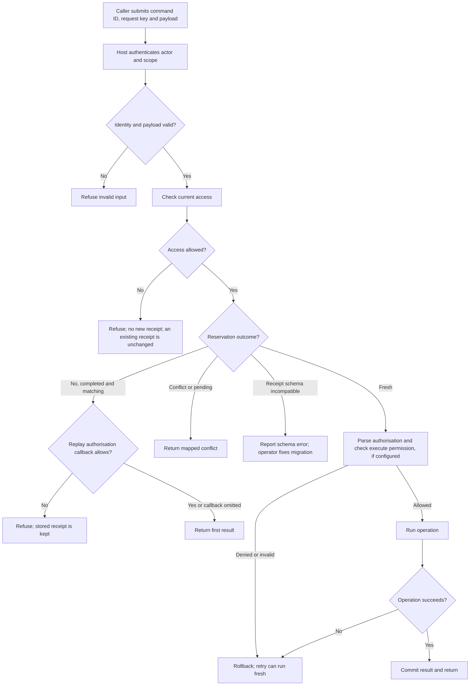
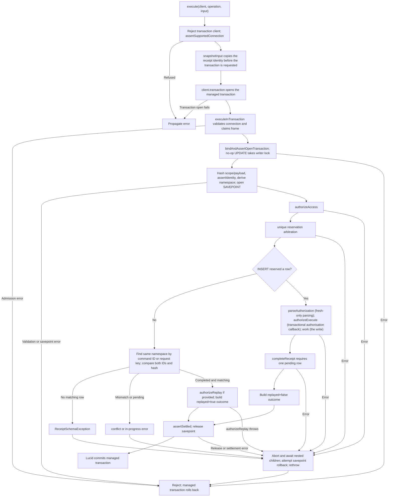

# US-GUARD-01 — Run a deduplicated operation once

As an operation caller, I want to submit an operation with a stable identity so that retries return its first result instead of applying the change twice.

**Status:** Current when using a supported better-sqlite3 connection and the required receipts migration.
**Access:** Host authenticates actor/scope and authorises access. Command identity is scoped to operation name and actor; payload plus scope must match for replay.
**Entry:** Host action calls `execute(client, operation, input)`; client supplies `commandId` and `requestKey`.
**Documentation:** [README use and contracts](../README.md#use)
**Source:** [`execute` and reservation pipeline](../src/receipts.ts)
**Coverage:** [`tests/execute.spec.ts`](../tests/execute.spec.ts), [`tests/values.spec.ts`](../tests/values.spec.ts)

## Acceptance criteria

| Input                                     | API parameter                | Required/default/conditions                                                                                                                                                                   |
| ----------------------------------------- | ---------------------------- | --------------------------------------------------------------------------------------------------------------------------------------------------------------------------------------------- |
| `actorId`, `scopeId`                      | String-typed identity values | Required by `ExecuteInput`; host derives identity and scope from trusted authentication and authorisation. No additional nonempty-string runtime check is promised.                           |
| `command.commandId`, `command.requestKey` | Client command identity      | Both required; must be well-formed Unicode strings. Preserve the pair on a retry. Operation name plus actor forms a separate receipt namespace.                                               |
| `payload`                                 | Operation payload            | Required JSON value; scope and payload are hashed together. Objects must be plain; arrays and finite numbers are allowed.                                                                     |
| `authorization`                           | Opaque optional input        | Parsed only for fresh reservations when `parseAuthorization` exists; omitted parser supplies `undefined`. A non-optional authorization type requires a parser in the public `Operation` type. |

- The package first acquires SQLite's writer lock, then validates payload/scope JSON and both command identifiers before any authorisation callback; `authorizeAccess` is the first authorisation callback and runs before reservation. Invalid payloads do not commit a receipt.
- `Operation` requires `name`, `authorizeAccess`, and `work`; omitted execute/replay authorisation callbacks allow their respective path. Use only the provided `trx` for database changes.
- A fresh reservation parses optional opaque authorisation, runs execute authorisation, calls `work`, and stores a plain JSON result in the same transaction. `execute` opens one transaction and does not retry automatically.
- Matching completed identity returns the stored JSON-equal result with `replayed: true`; a mismatched request key, command ID or payload conflicts, re-entering the same pending operation from `work` or `authorizeExecute` (both run after the pending insert) reports in-progress, and any fresh-path failure rolls back receipt and writes.
- Non-JSON values (including cycles, dates, non-finite numbers, symbols and class instances) are refused; `-0` replays as `0`.

- Preserve both command identifiers on retries. Property order does not change the payload hash, while a changed scope or JSON value conflicts within the same operation and actor. Keep the payload unchanged until the call settles. Invalid input raises `E_INVALID_COMMAND_VALUE`; an invalid work result raises `E_INVALID_COMMAND_RESULT` and rolls back the work. See [identity cases](../tests/identity.spec.ts) and [JSON value cases](../tests/values.spec.ts).

## User flow

## Code flow

Scope: package operation path; caller authentication, HTTP response shaping, and response presentation remain host-owned; operation callbacks must be database-only.

**Code references:** [API](../index.ts), [execute](../src/receipts.ts#L693), [Operation](../src/types.ts#L41)
