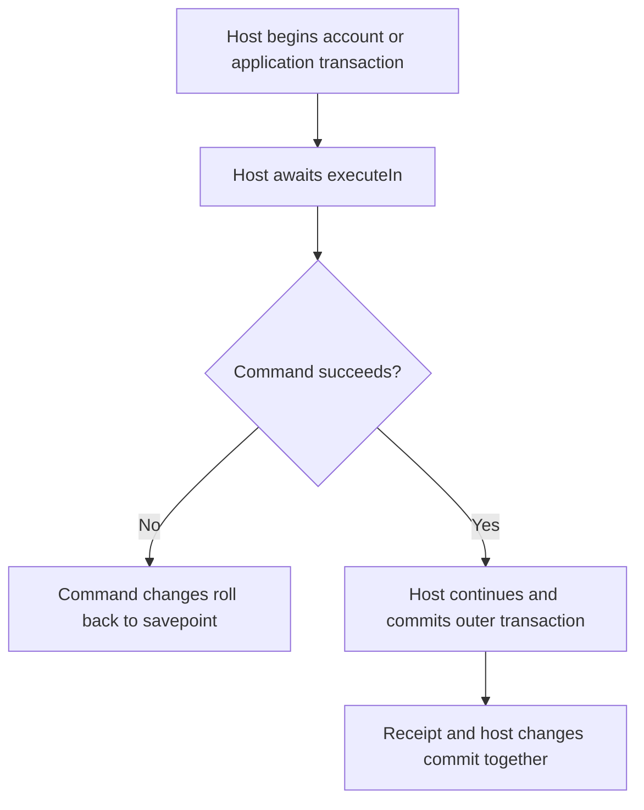
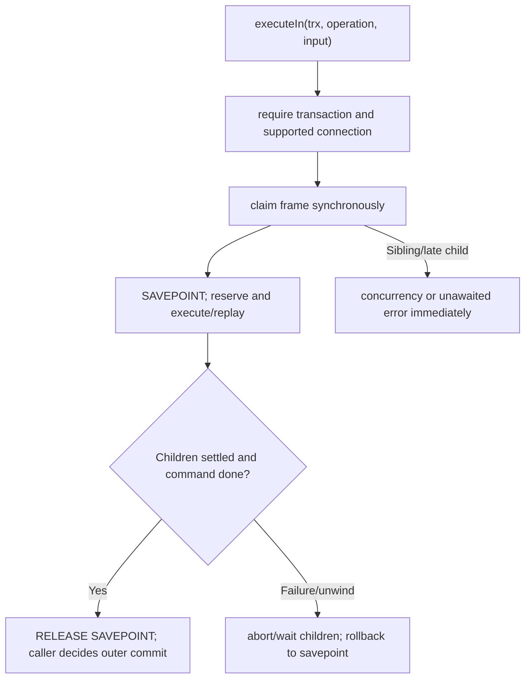

# US-GUARD-02 — Guard a command inside a host transaction

As a transaction owner, I want a guarded command to share my transaction so that its receipt and writes commit or roll back with the surrounding account operation.

**Status:** Current with an active transaction client; callers must await sequential commands or use supported nesting.
**Access:** Host owns transaction (for example Account Kit `withCurrent`); only better-sqlite3, pool max 1, one Lucid connection per SQLite file.
**Entry:** Call `executeIn(trx, operation, input)` inside the transaction callback.
**Documentation:** [README transaction contracts](../README.md#contracts)
**Source:** [`executeIn`](../src/receipts.ts)
**Coverage:** [`tests/nesting.spec.ts`](../tests/nesting.spec.ts), [`tests/rollback.spec.ts`](../tests/rollback.spec.ts), [`tests/connections.spec.ts`](../tests/connections.spec.ts)

## Acceptance criteria

- `execute` rejects transaction clients; `executeIn` rejects non-transaction clients.
- Each command uses a savepoint on the caller transaction; nested `executeIn` is supported from the innermost command policies/work.
- Sibling calls and calls with lost async context fail immediately with `E_CONCURRENT_COMMAND`. A late nested call from a closing frame, or a parent finishing with an open nested command, fails with `E_UNAWAITED_NESTED_COMMAND`. Parent unwinding aborts and waits for children before rollback; a child that never settles keeps the parent waiting.
- Policies and `work` must be database-only and safe to rerun if the transaction owner reruns its callback. Do not wrap either API in an independent retry loop.
- Original SQLite transaction-abort errors propagate; failed savepoint cleanup is attached as `cause` when possible.
- Host queries issued on `trx` while a command is open are inside its savepoint and roll back if that command fails.

## User flow

## Code flow

Scope: package command path; caller authentication, HTTP response shaping, and external side effects remain host-owned.

**Code references:** [executeIn](../src/receipts.ts#L257), [savepoint and nested execution](../src/receipts.ts#L300), [types](../src/types.ts#L8)
