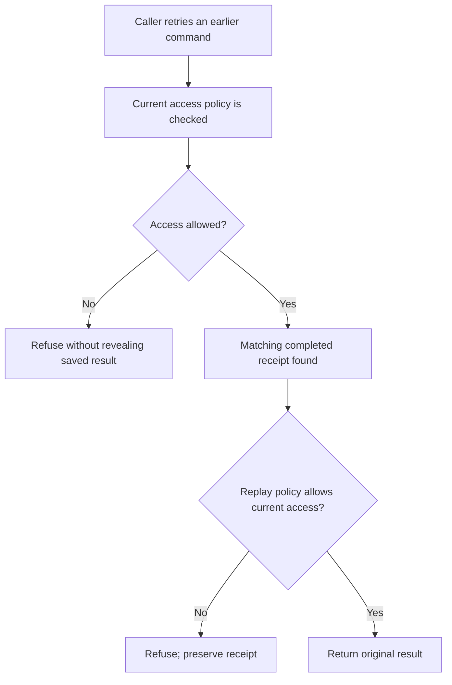
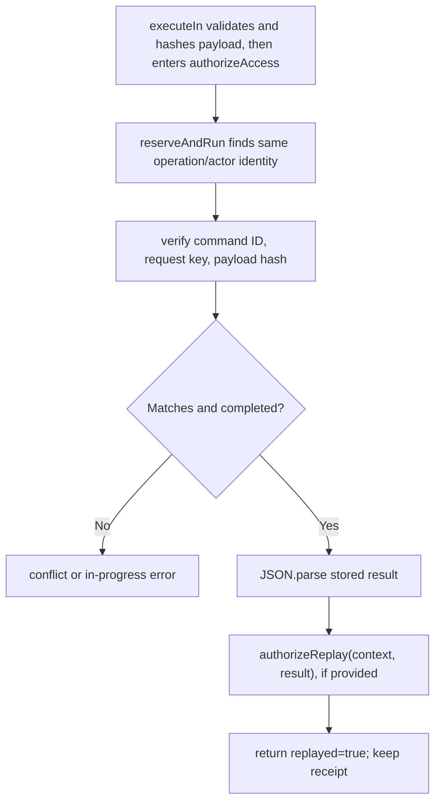

# US-GUARD-03 — Reauthorize access before replaying a result

As a command caller, I want the guard to check current access before returning a saved result so that a retry does not disclose data after permissions change.

**Status:** Current.
**Access:** `authorizeAccess` runs for fresh and replay calls after initial payload validation; optional `authorizeReplay` runs on completed matching replay. Omission permits replay after access policy passes.
**Entry:** Call `execute` or `executeIn` using the original operation namespace and identity.
**Documentation:** [README operation policy order](../README.md#use)
**Source:** [`reserveAndRun`](../src/receipts.ts)
**Coverage:** [`tests/optional_policies.spec.ts`](../tests/optional_policies.spec.ts), [`tests/identity.spec.ts`](../tests/identity.spec.ts)

## Acceptance criteria

- Access denial occurs before reservation and does not expose or change a receipt.
- A matching completed result is returned only after `authorizeReplay` succeeds; if that callback throws, the completed receipt remains available for a later permitted attempt.
- `parseAuthorization` and `authorizeExecute` apply only to a fresh reservation; they are not rerun during replay.
- Another actor using the same client IDs is in a separate namespace and learns nothing about the first actor’s result.

## User flow

## Code flow

Scope: package command path; caller authentication, HTTP response shaping, and external side effects remain host-owned.

**Code references:** [policy order](../README.md#use), [replay branch](../src/receipts.ts#L370), [namespace construction](../src/receipts.ts#L317)
