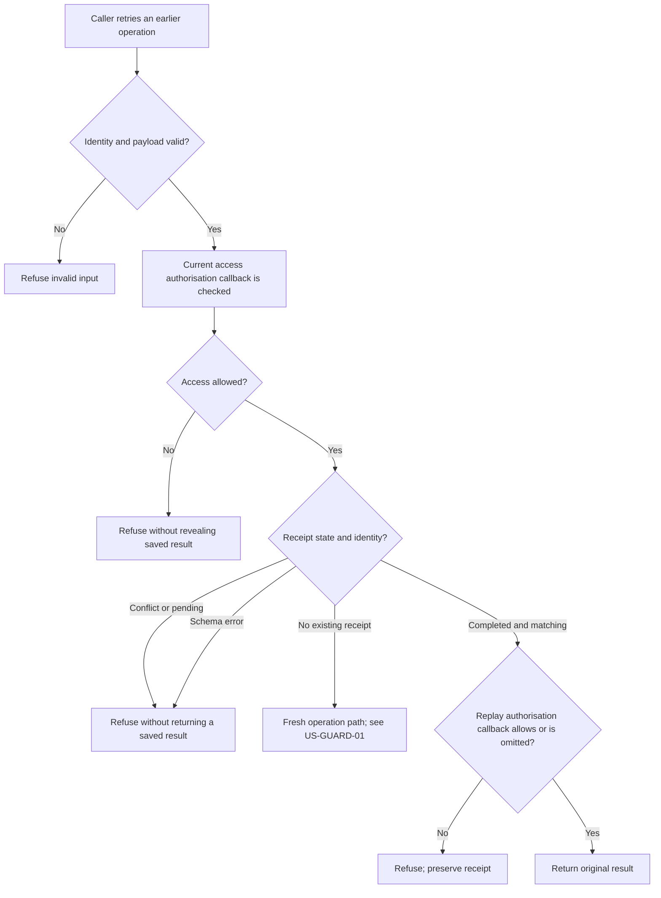
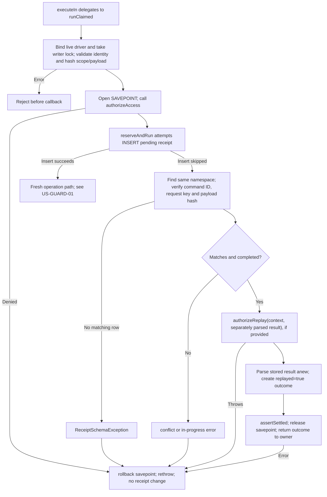

# US-GUARD-03 — Reauthorise access before replaying a result

As an operation caller, I want request deduplication to check current access before returning a saved result so that a retry does not disclose data after permissions change.

**Status:** Current.
**Access:** `authorizeAccess` runs for fresh and replay calls after initial payload validation; optional `authorizeReplay` runs on completed matching replay. Omission permits replay after access authorisation callback passes.
**Entry:** Call `execute` or `executeIn` using the original operation namespace and identity.
**Documentation:** [README operation authorisation callback order](../README.md#use)
**Source:** [`reserveAndRun`](../src/receipts.ts)
**Coverage:** [`tests/optional_policies.spec.ts`](../tests/optional_policies.spec.ts), [`tests/identity.spec.ts`](../tests/identity.spec.ts)

## Acceptance criteria

- Access denial occurs before reservation and does not expose or change a receipt.
- A matching completed result is returned only after `authorizeReplay` succeeds; if that callback throws, the completed receipt remains available for a later permitted attempt.
- `parseAuthorization` and `authorizeExecute` apply only to a fresh reservation; they are not rerun during replay.
- Another actor using the same client IDs is in a separate namespace and learns nothing about the first actor’s result.

- The optional replay callback receives the current operation context and a separate parsed copy of the stored result. Mutating that copy does not change the result returned to the caller. When the callback is omitted, successful current access suffices. The opaque fresh authorisation is never read on the replay branch. See [optional authorisation callback combinations](../tests/optional_policies.spec.ts) and the [replay branch](../src/receipts.ts#L606).

## User flow

## Code flow

Scope: package operation path; caller authentication, HTTP response shaping, and external side effects remain host-owned.

**Code references:** [authorisation callback order](../README.md#use), [replay branch](../src/receipts.ts#L607), [namespace construction](../src/receipts.ts#L488), [refusal rollback](../src/receipts.ts#L525)
