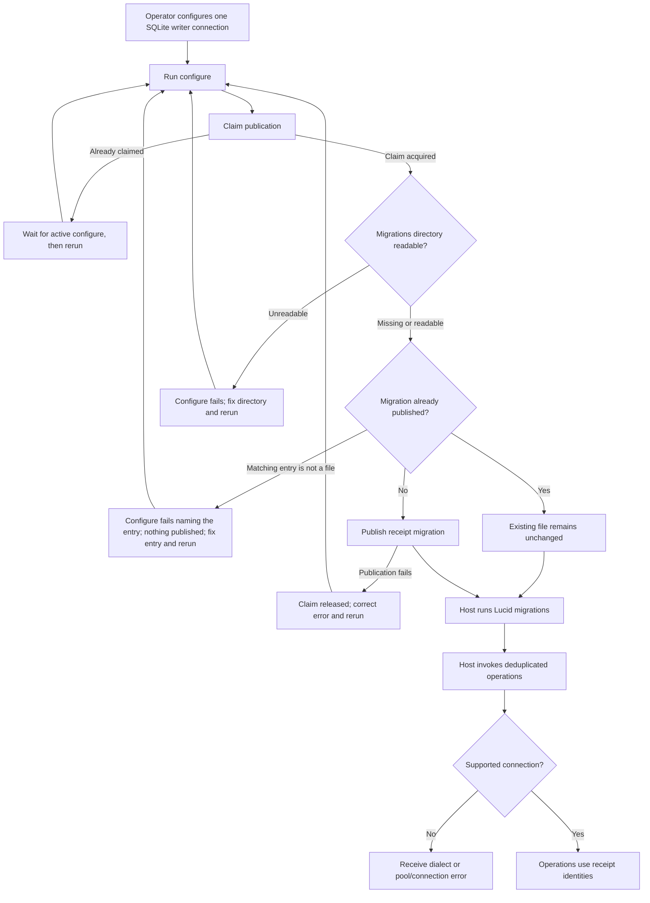
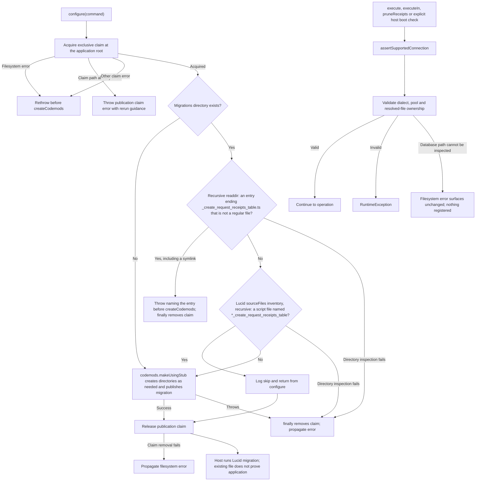

# US-GUARD-04 — Install receipt storage

As an application operator, I want to configure the receipt table and a supported SQLite connection so that deduplicated operations can reserve and complete durable identities.

**Status:** Operator.
**Access:** Host operator with migration and connection configuration access.
**Entry:** `node ace configure @kevinjohn/adonisjs-request-deduplication`, followed by `node ace migration:run`.
**Documentation:** [Install and connection contracts](../README.md#install).
**Source:** [configure](../configure.ts), [connection validation](../src/receipts.ts).
**Coverage:** [Configure tests](../tests/configure.spec.ts), [connection tests](../tests/connections.spec.ts).

## Acceptance criteria

- Configure publishes the receipts migration once. It looks in the migrations directory and every subdirectory below it. An existing regular script file that Lucid's recursive migration inventory lists (`.ts` other than `.d.ts`, `.js`, `.mjs` or `.cjs`) and whose name without its extension ends `_create_request_receipts_table` counts as installed and is left unchanged, whatever its extension.
- Any entry ending `_create_request_receipts_table.ts` that is not a regular file stops configure with an error naming it, before anything is published: a directory, a broken link, and also a symbolic link that resolves to a regular migration file, which Lucid's inventory does not list. Replace it with a regular migration file or remove it, then rerun.
- An installed file does not prove storage exists: Lucid must still apply the migration; its down migration drops the receipts table and its replay history.
- A missing migrations directory counts as no existing migration and the migration is published. Any other read failure of the migrations directory (for example permissions, or a file in its place) stops configure with that error before anything is published; fix the directory and rerun.
- Configure takes an exclusive publication claim before checking for an existing migration. A simultaneous run fails with a rerun diagnostic; once publication finishes, a rerun preserves the migration. A failed publication releases the claim. The operator may remove a stale empty lock directory only after confirming no configure is still running.
- The migration creates `request_receipts` with unique operation/command-ID and operation/request-key indexes. An outdated cross-actor unique index can produce `E_RECEIPT_SCHEMA`; the host must use the current schema.
- Public operations require better-sqlite3 and pool maximum one (the default). A competing open Lucid connection is refused when another still-open connection to the same resolved database file was registered by an operation or `assertSupportedConnection`; closed owners are pruned. Unregistered external writers, hard-linked paths and `file:` URI filenames are not detected. Each in-memory or blank-filename connection is independent. A file not created yet is identified through its directory's real path; any other failure to resolve the database path (for example a link loop, or a file used as a directory) surfaces as that filesystem error and the path is not registered.
- The package provides APIs and a migration hook, without mounting HTTP routes or a scheduled cleanup job.

## User flow

## Code flow

Scope: configure publication and connection validation; application migration execution is owned by Lucid.

**Code references:** [Configure hook](../configure.ts), [migration](../stubs/make/migration/create_request_receipts_table.stub), [connection check](../src/receipts.ts#L642).
