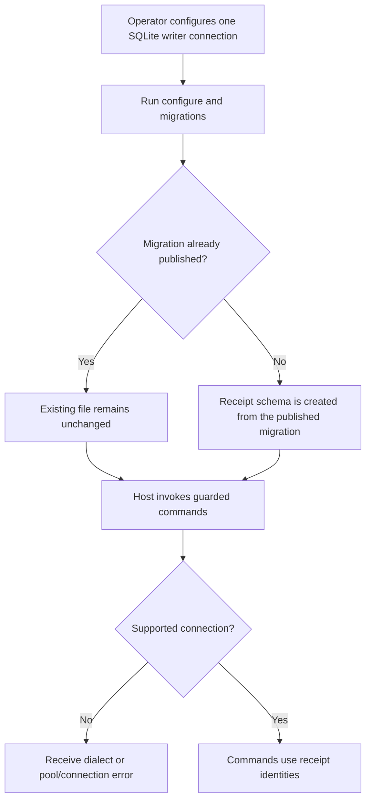
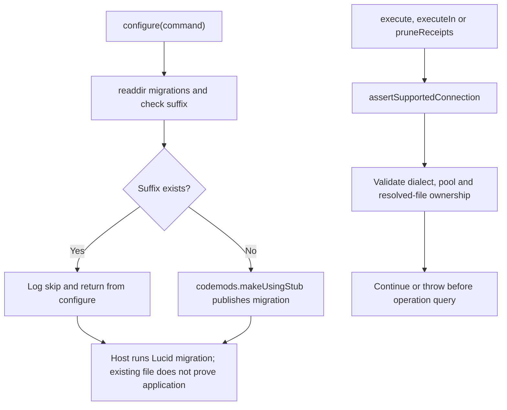

# US-GUARD-04 — Install receipt storage

As an application operator, I want to configure the receipt table and a supported SQLite connection so that guarded commands can reserve and complete durable identities.

**Status:** Operator.
**Access:** Host operator with migration and connection configuration access.
**Entry:** `node ace configure @kevinjohn/adonisjs-duplicate-request-guard`, followed by `node ace migration:run`.
**Documentation:** [Install and connection contracts](../README.md#install).
**Source:** [configure](../configure.ts), [connection validation](../src/receipts.ts).
**Coverage:** [Configure tests](../tests/configure.spec.ts), [connection tests](../tests/connections.spec.ts).

## Acceptance criteria

- Configure publishes the receipts migration once; an existing filename with `_create_request_receipts_table.ts` suffix is left unchanged.
- The migration creates `request_receipts` with unique operation/command-ID and operation/request-key indexes. An outdated cross-actor unique index can produce `E_RECEIPT_SCHEMA`; the host must use the current schema.
- Public operations require better-sqlite3 and pool maximum one. A second open Lucid connection previously registered by guarded operations for the same resolved database file is refused; closed owners are pruned. Unregistered external writers are not detected. Each in-memory connection is independent.
- The package provides APIs and a migration hook, without mounting HTTP routes or a scheduled cleanup job.

## User flow

## Code flow

Scope: configure publication and connection validation; application migration execution is owned by Lucid.

**Code references:** [Configure hook](../configure.ts), [migration](../stubs/migrations/create_request_receipts_table.stub), [connection guard](../src/receipts.ts#L104).
