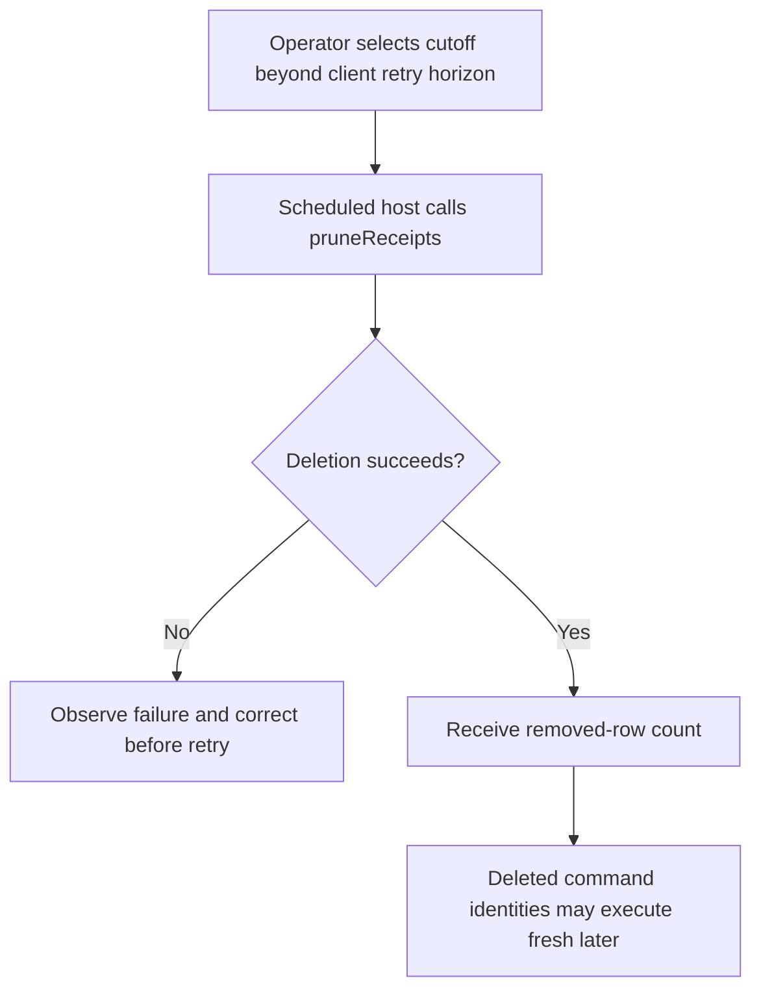
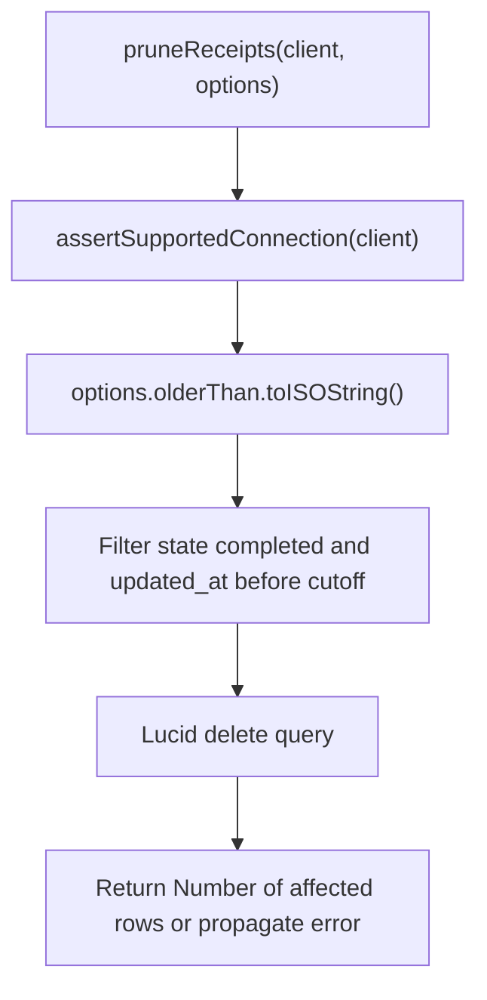

# US-GUARD-05 — Remove completed receipts past the retry horizon

As an application operator, I want to prune completed receipts only after clients can no longer legitimately retry them so that storage is bounded without reopening recent commands.

**Status:** Operator.
**Access:** Host scheduler/operator with a supported better-sqlite3 connection and authority to choose retention.
**Entry:** `pruneReceipts(client, { olderThan })`; no package scheduler or Ace pruning command is provided.
**Documentation:** [Pruning contract](../README.md#contracts).
**Source:** [pruneReceipts](../src/receipts.ts#L455).
**Coverage:** [Prune tests](../tests/prune.spec.ts).

## Acceptance criteria

- `olderThan` is a required JavaScript `Date` supplied by the host. No retention default exists; choose it based on the maximum client retry horizon.
- Only completed receipts with `updated_at` strictly earlier than `olderThan.toISOString()` are deleted. Pending and equal-cutoff rows remain.
- The method returns the deleted-row count. A later call using a deleted identity executes fresh and can apply the operation again.
- Supported-connection checks apply before deletion; database and invalid date failures propagate. Host owns scheduling and any surrounding transaction.

## User flow

## Code flow

Scope: public pruning API through Lucid deletion; retention policy and scheduling remain host-owned.

**Code references:** [pruneReceipts](../src/receipts.ts#L455), [PruneOptions](../src/types.ts), [pruning tests](../tests/prune.spec.ts).
