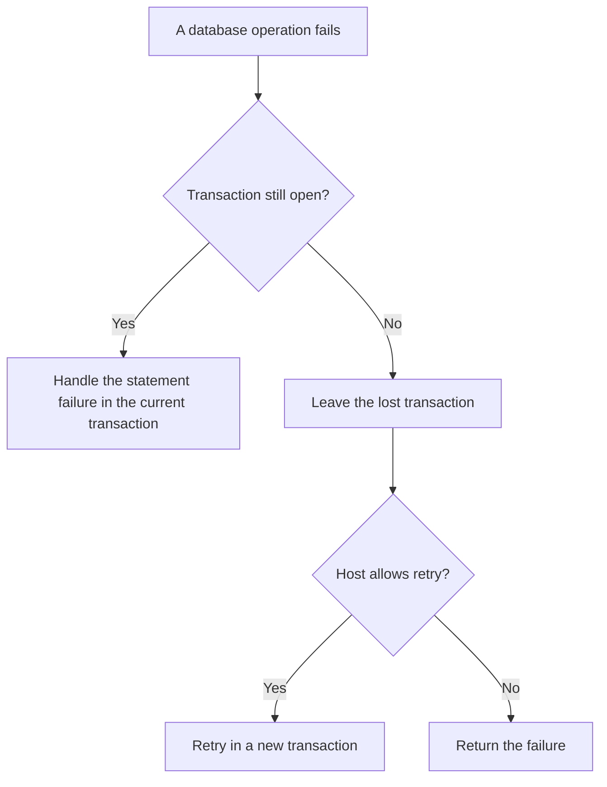
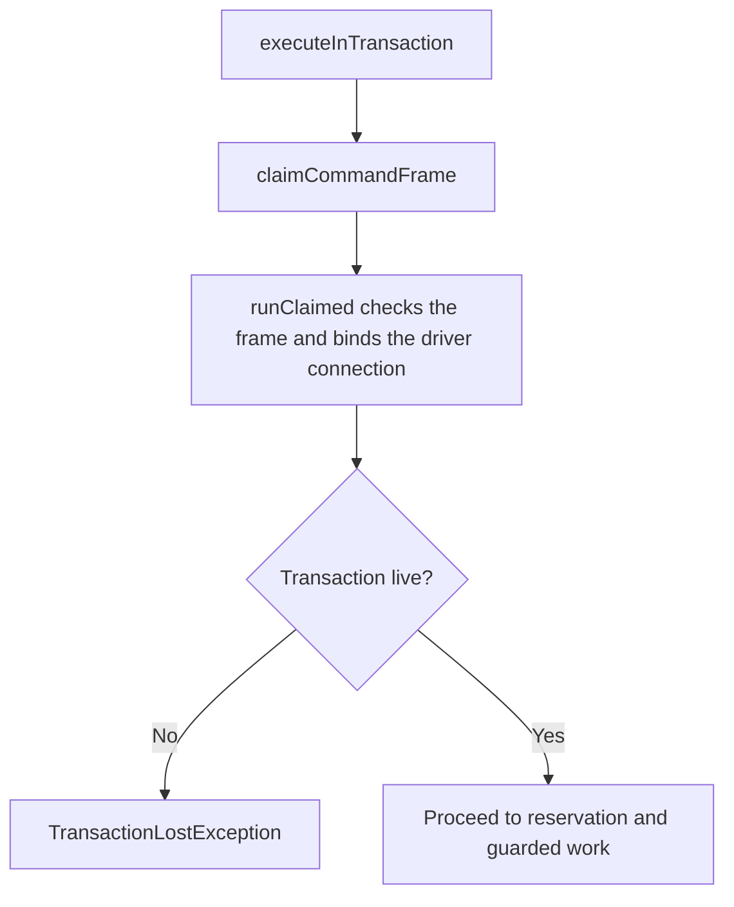

# US-GUARD-06 — Recover after a transaction ends unexpectedly

As the host transaction owner, I want to recognise when SQLite has ended my transaction so that I can abandon the stale client and safely rerun eligible database work.

**Status:** Current.
**Access:** Host application using a supported Lucid connection.
**Entry:** A failed guarded call, or a subsequent `executeIn(trx, operation, input)` on the affected client.
**Documentation:** [Transaction contracts](../README.md#contracts)
**Source:** [Transaction watcher and admission](../src/receipts.ts#L265)
**Coverage:** [Transaction loss and recovery](../tests/lost_transaction.spec.ts)

## Acceptance criteria

- A SQLite error that aborts the transaction can reach the host as the original driver error. A subsequent guarded operation on that transaction raises `E_TRANSACTION_LOST` before its work runs. A raw host commit also ends the transaction. An ordinary statement failure that leaves the transaction open allows further operations.
- Catching the abort, opening a savepoint or starting a child transaction on the affected connection cannot revive the lost owner. An enclosing guarded call that swallowed the loss is stopped at its next liveness check.
- End the failed owner’s scope. A newly acquired transaction on the same pooled connection can run operations again. A late call on an already completed client is refused without poisoning the new owner.
- A managed `execute` handles its own rollback after transaction loss. The host decides whether its application operation can be attempted again and preserves the original identity and payload on retries.

## User flow

## Code flow

**Code references:** [bindAndAssertOpenTransaction](../src/receipts.ts#L303), [runClaimed](../src/receipts.ts#L470), [TransactionLostException](../src/errors.ts#L146).
